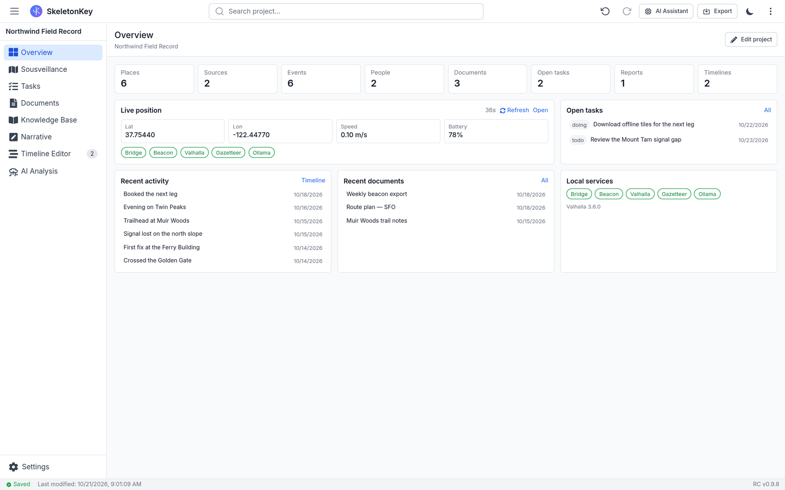
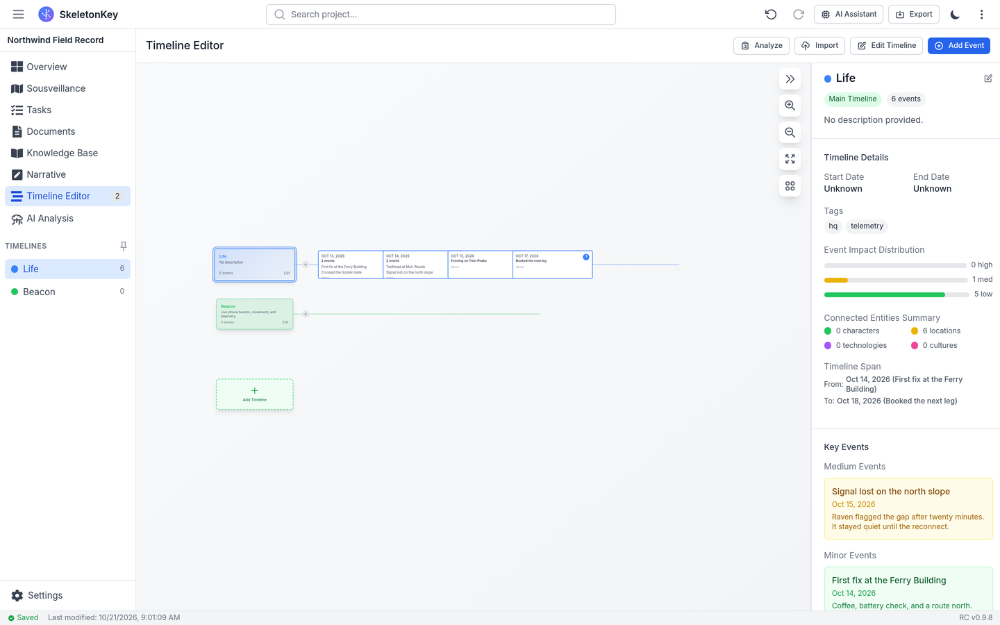
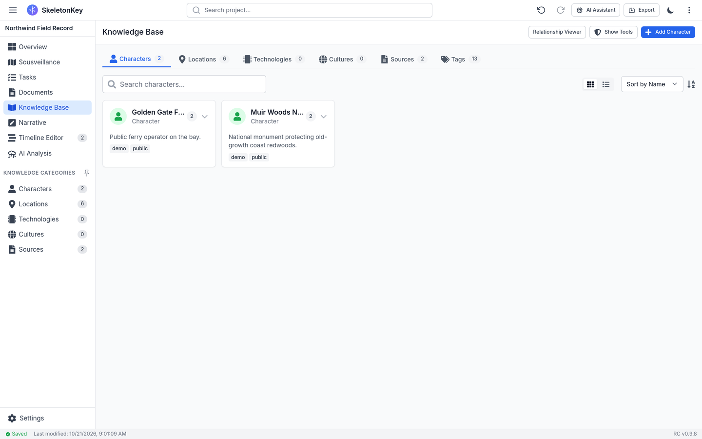
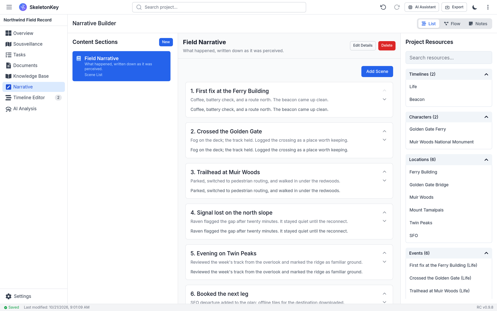
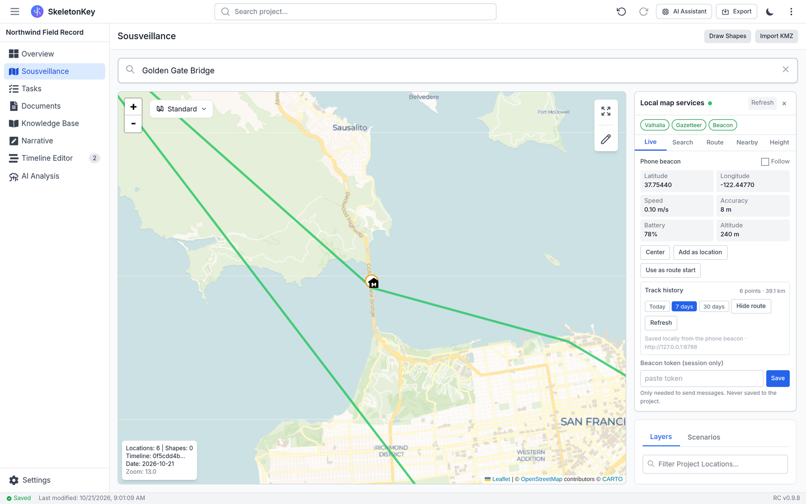
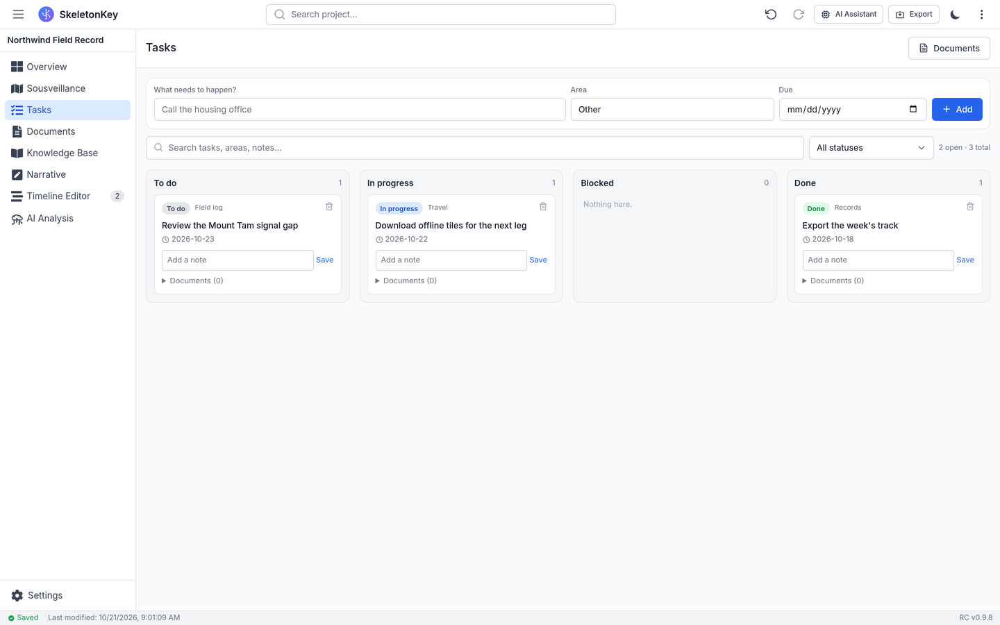
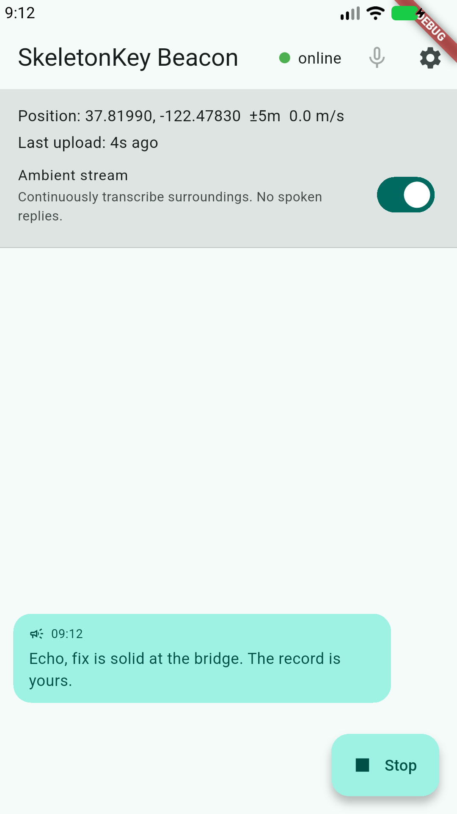
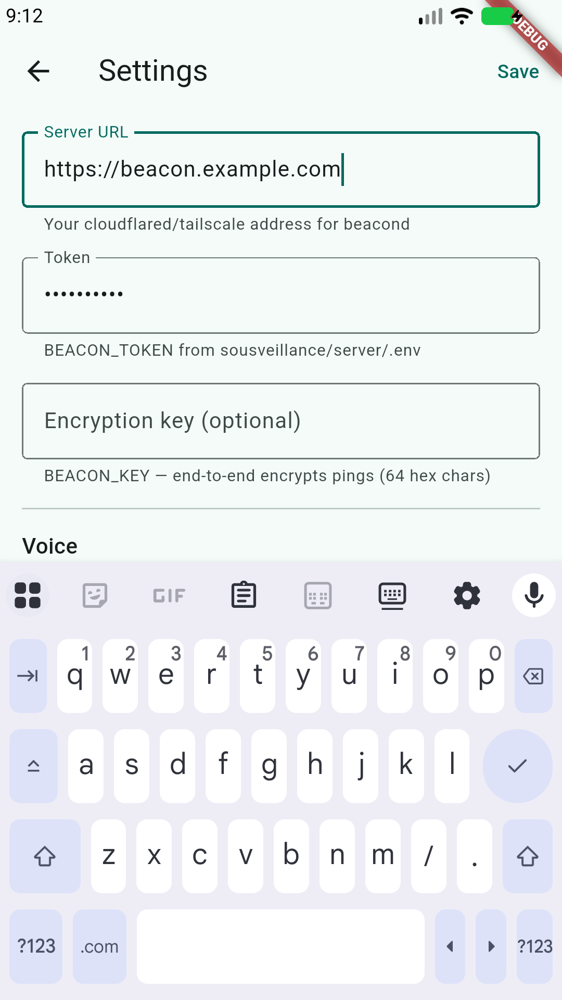
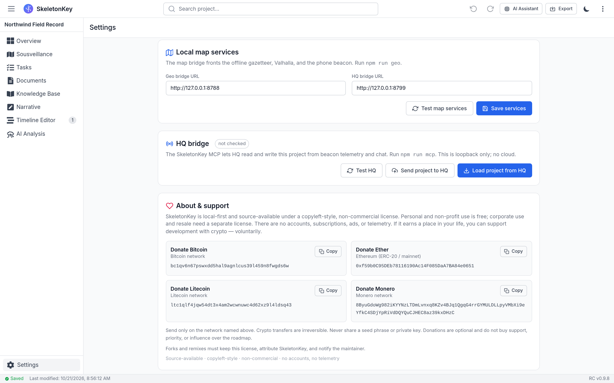

# SkeletonKey

**A local-first personal record and self-sousveillance framework.**

SkeletonKey is a desktop app, a phone beacon, an offline map stack, and a small
fleet of local agents that keep one record of *your* life — with your consent,
for your benefit, on your hardware.

Surveillance is asymmetric: institutions get cameras, databases, fusion centers,
and analysts; you get a privacy policy. Sousveillance is the personal
counterpart — **the same class of tools, pointed at yourself, by your own
consent**. Not to replace power, and not to watch other people. To hold your own
eye: your own picture of your own life, unmediated.

This repository contains the whole loop:

- a **desktop record** (timelines, places, people, documents, narratives, money,
  plans) that runs as a Tauri app or in a browser;
- a **phone beacon** that streams position, battery, and barometric altitude,
  speaks and listens on-device, and can run a silent ambient transcript;
- **offline maps** — Valhalla routing, a local OSM gazetteer, and elevation;
- a **watch** (Raven Protocol) that speaks only when something is actually wrong;
- a **tiered field log** (raw → daily digest → narrative → legend);
- **MCP servers** that give an agent read access and gated write access to the
  same record;
- **agent personas** (HQ, its cloud arm, the general assistant) and an optional
  **WhatsApp bridge** so the handler can reach you in the field.

All of it is generic, key-free by default, and safe to publish: there are no
author secrets, phone numbers, API keys, signing identities, or personal
endpoints in this tree. See [`.env.example`](.env.example) and
[`integrations/whatsapp/.env.example`](integrations/whatsapp/.env.example).

---

## Contents

- [Why this exists](#why-this-exists)
- [What is in the box](#what-is-in-the-box)
- [Models and agency quality](#models-and-agency-quality)
- [Self-extension, with consent](#self-extension-with-consent)
- [Wallet watch (optional)](#wallet-watch-optional)
- [Screenshots](#screenshots)
- [Architecture](#architecture)
- [Repository layout](#repository-layout)
- [Quick start](#quick-start)
  - [1. Desktop app](#1-desktop-app)
  - [2. Local bridges and MCP servers](#2-local-bridges-and-mcp-servers)
  - [3. Sousveillance server](#3-sousveillance-server)
  - [4. Offline maps](#4-offline-maps)
  - [5. Agents and MCP wiring](#5-agents-and-mcp-wiring)
  - [6. Phone beacon](#6-phone-beacon)
  - [7. Optional WhatsApp transport](#7-optional-whatsapp-transport)
- [The record](#the-record)
- [MCP tools](#mcp-tools)
- [Configuration](#configuration)
- [Privacy and threat model](#privacy-and-threat-model)
- [Security and consent](#security-and-consent)
- [Troubleshooting](#troubleshooting)
- [About and support](#about-and-support)
- [Status and limits](#status-and-limits)
- [License](#license)

---

## Why this exists

Most technology that knows where you are is owned by someone else. The data is
extracted, aggregated, and used to predict or influence you. Even well-meaning
"quantified self" apps usually ship your life to a vendor cloud.

SkeletonKey inverts the arrangement:

1. **The observer is you.** The system watches *one* person, the operator, by
   explicit consent. It is not a people-tracker and must never become one.
2. **The frame is yours.** Position, history, documents, and memory live on
   your machine. You can export them, inspect them, delete them, and run the
   whole thing offline.
3. **The tools are symmetric.** You get the same capabilities institutions use
   on you — location history, geofencing, pattern-of-life, entity and document
   analysis, proactive alerts, a persistent narrative — applied to yourself.
   The point is not secrecy; it is **agency**.
4. **The machine advises; you decide.** Every state change is gated. Every
   alert traces to real data. The system never invents a threat, a distance, a
   person, or a place.
5. **There is an off-ramp.** Delete the record, stop the beacon, unplug the
   agent. A tool for freedom that cannot be turned off is not a tool for
   freedom.

This is the digital analogue of keeping your own records instead of relying on
someone else's file about you. It is not a license to surveil anyone else. See
[Security and consent](#security-and-consent).

---

## What is in the box

| Component | What it does |
|---|---|
| **SkeletonKey desktop** | Tauri + React app. Timelines/branches, events, locations and maps, entities, characters, source documents, narrative builder, money/plans, search, import/export (`.ark` JSON). |
| **Beacon server** (`sousveillance/server`) | `beacond` ingests encrypted position pings, keeps a track, pushes spoken messages to the phone, and answers `/ask`. |
| **Field log** | Tiered memory: raw events → daily digests → compacted narrative → private legend. Continuity without hoarding. |
| **Raven Protocol** | Proactive watch: lost signal, reconnect, long stall, motion anomaly, geofence, dusk. Silent unless it matters. |
| **Offline maps** (`sousveillance/maps`) | Valhalla routing, local gazetteer (`overlay.sqlite`), elevation, and a `geo` CLI. No API keys, no cloud. |
| **Phone app** (`sousveillance/app`) | Flutter/Android beacon: GPS + battery + altitude, on-device TTS/STT, push-to-talk, ambient transcript, AES-256-GCM uplink. |
| **MCP servers** (`mcp/`, `sousveillance/*/mcp-server.mjs`) | `skeletonkey`, `skeletonkey-hq`, `beacon`, and `geo` tools over stdio. |
| **Agent personas** (`agents/`) | HQ (field handler), HQ-cloud (deep reasoning), and the WhatsApp assistant. |
| **WhatsApp bridge** (`integrations/whatsapp`) | Optional transport: drive an agent from a WhatsApp chat, with image routing and approvals. |
| **Wallet watch** (`integrations/crypto-watch`) | Optional BTC/LTC/ETH polling and a view-only XMR watcher, with an MCP for `wallet_status`, `wallet_events`, and `wallet_notify`. |


## Models and agency quality

The MCP servers, the record, and the maps are local. The **model** is what turns
them into an agent. Put plainly: **the quality of MCP/HQ agency is directly
related to the quality of the model used.** Tool use is a hard test: the model has to choose the right
tool, build valid arguments, read the result, recover from errors, and keep the
thread across steps without inventing facts. A weak model produces weak agency —
missed calls, malformed arguments, dropped context, confident false statements.
A strong model plans better and is less likely to bluff, which matters when HQ
can read your location and propose changes to your record.

**What our testing showed.** Frontier models gave the best results. Mythos, Sol,
and DeepSeek v4.1 Flash were the strongest at multi-step tool use and staying
grounded in real data. Small local models were not reliable enough for the HQ
role in our testing. Model names and versions move quickly, so treat this as a
starting point, not a permanent ranking — **test the model yourself** against
the tools and the record you actually use, and keep the model that passes.

### Local vs cloud

| | Local model | Cloud model |
|---|---|---|
| Where inference runs | your hardware | the provider's servers |
| Your project data | stays on your machine | leaves your machine to the provider |
| Agency quality | limited by model size and your hardware | frontier-class in practice |
| Works offline | yes | no |
| Marginal cost | hardware and electricity | per token |
| Best for | privacy-critical or disconnected use | hard planning and tool use |

**The local-only ethos has a price.** Any cloud model sends the context the
agent gives it to that provider: the parts of the project it reads, your
location, chat messages, attachments, and tool results. That data may be
logged, retained, or used under the provider's terms. A cloud model is a real
data-egress path — it breaks the local-only promise in exchange for better
assistant processing. If local-only is non-negotiable, run a local model (a
frontier-class one needs serious hardware) and accept that agency may be
weaker. A hybrid is possible: local by default, escalate a hard turn to the
cloud arm (`agents/hq-cloud.md`), but the escalated context goes to the cloud.
If you use a cloud model, do not put secrets in the record.

## Self-extension, with consent

The suite is allowed to grow, but never silently. If HQ notices a concrete,
recurring or high-value gap — something a small local tool, MCP, skill, or
automation would do better — it can propose an extension.

- **From ambient text:** during silent ingestion, HQ may return an `extension`
  object (kind, gap, proposal, why, risk, requires). The server records it and
  queues the question; the ambient extraction itself still never speaks.
- **From any turn:** HQ calls `beacon_extension_propose`.
- **Ask, don't act:** the proposal is stored locally and asked as a yes/no on
  the phone and in the WhatsApp HQ chat. No code is written and no tool is added
  before the operative says yes.
- **After yes:** HQ calls `beacon_extensions` to read the pending proposal,
  builds the smallest safe local extension, adds a test and docs, and records
  the decision with `beacon_extension_decide`. A new dependency, elevated
  access, or a restart needs a second yes.
- **After no:** the proposal is marked denied and is never retried.
- **Hard limits:** no extension for surveillance of another person, for
  credential collection, for telemetry, or to weaken permissions. The override
  rule still applies.

Proposals live in the local beacon SQLite store. Cooldowns and deduplication
keep it from nagging; unanswered proposals expire.

## Screenshots

> Captured from the running app against a **synthetic demo record**. The places
> are real; the events, documents, and person are not. No real location, token,
> or personal record is shown. See [`docs/screenshots/`](docs/screenshots/).

| Desktop | |
|---|---|
|  |  |
| **Overview** — places, live position, recent activity, documents, open tasks, local service health. | **Timeline** — the week's events and the Beacon timeline. |
|  |  |
| **Knowledge Base** — entities, locations, and sources. | **Narrative** — the tiered field narrative and scene list. |
|  |  |
| **Sousveillance map** — project locations, route/track, and local map services. | **Tasks** — work grouped by status and area. |

| Phone beacon | |
|---|---|
|  |  |
| **Live** — fix, link status, ambient stream, and an HQ message in the earpiece. | **Settings** — server URL, token, optional encryption key, and on-device voice. |

---

## Architecture

```
                    ┌──────────────────────────────┐
                    │  SkeletonKey desktop / web   │
                    │  timelines · map · documents │
                    │  narrative · search · money  │
                    └──────────────┬───────────────┘
                                   │ loopback HTTP
             ┌─────────────────────┼─────────────────────┐
             ▼                     ▼                     ▼
   ┌──────────────────┐  ┌──────────────────┐  ┌──────────────────┐
   │ skeletonkey MCP  │  │    geo bridge    │  │   setup service  │
   │  :8799 (+ HTTP)  │  │      :8788       │  │      :8797       │
   └────────▲─────────┘  └───┬──────────┬───┘  └──────────────────┘
            │                │          │
            │          ┌─────▼─────┐    │
            │          │ Valhalla  │    │
            │          │  :8002    │    │
            │          └───────────┘    │
            │          gazetteer        │
            │          overlay.sqlite   │
            │                           │
   ┌────────┴─────────┐        ┌────────▼─────────┐
   │  opencode agent  │        │     beacond      │
   │  HQ + MCP tools  │        │      :8787       │
   └────────▲─────────┘        └────────▲─────────┘
            │                           │ encrypted WSS
   ┌────────┴─────────┐        ┌────────┴─────────┐
   │ WhatsApp bridge  │        │   phone beacon   │
   │   (optional)     │        │  GPS · mic · TTS │
   └──────────────────┘        └──────────────────┘
```

Everything inside the boundary runs on your machine. The outbound calls are the
model you choose, a few public feeds (weather, hazards) with coordinates
truncated before the request, and — only if you enable it — the public chain APIs
used by the wallet watch. A cloud model is a full data-egress path; see
[Models and agency quality](#models-and-agency-quality).

---

## Repository layout

```
SkeletonKey/
├── src/                     React frontend
├── src-tauri/               Tauri (Rust) shell
├── mcp/
│   ├── skeletonkey-mcp.mjs  record tools + HTTP bridge (:8799)
│   ├── hq-mcp.mjs           unified control plane for agents
│   └── test-client.mjs
├── tools/
│   ├── geo-http.mjs         map/beacon/opencode/ollama bridge (:8788)
│   ├── setup-http.mjs       setup/status service (:8797)
│   └── import-caseworker.mjs
├── scripts/setup/           Ollama, maps, services, agents
├── deploy/                  example systemd user units
├── agents/                  HQ, HQ-cloud, WhatsApp personas
├── docs/                    maps, single-project, and operator notes
├── integrations/
│   ├── whatsapp/            optional WhatsApp Agent Platform bridge
│   └── crypto-watch/        optional wallet watcher + MCP (BTC/LTC/ETH/XMR)
└── sousveillance/           the self-sousveillance framework
    ├── server/              beacond · raven · fieldlog · weather · hazards · MCP
    ├── maps/                Valhalla setup · `geo` CLI · geo MCP · gazetteer
    └── app/                 Flutter/Android beacon
```

---

## Quick start

> Requirements vary by component. The desktop app needs **Node ≥ 20** and (for
> the native shell) **Rust + Tauri**; the beacon needs **Node ≥ 22**; the maps
> need **Valhalla + osmium-tool**; the phone app needs **Flutter + Android
> SDK**. None of them require an account.

### 1. Desktop app

```bash
git clone <your-fork> SkeletonKey
cd SkeletonKey
pnpm install                # or npm install
pnpm dev                    # browser dev server on 127.0.0.1:1420
pnpm tauri dev              # native desktop window
pnpm build                  # production web build
```

The single main record is `~/Documents/SkeletonKey/main.ark` in the desktop app,
or one stable localStorage slot in the browser build. See
[`docs/single-project.md`](docs/single-project.md).

### 2. Local bridges and MCP servers

```bash
pnpm geo                    # geo + beacon + fieldlog bridge on :8788
pnpm mcp                    # SkeletonKey MCP and project bridge on :8799
pnpm setup                  # setup/status UI service on :8797 (optional)
```

The desktop shell starts these automatically if their ports are free. They are
loopback-only. Install them as user services with:

```bash
bash scripts/setup/services.sh
```

### 3. Sousveillance server

```bash
cd sousveillance/server
npm install                 # this sub-project uses npm
cp ../.env.example .env
openssl rand -hex 32        # paste as BEACON_TOKEN
openssl rand -hex 32        # paste as BEACON_KEY (enables E2E encryption)
npm start                   # beacond on 127.0.0.1:8787
```

Then install the watch/memory timers:

```bash
cp systemd/*.service systemd/*.timer ~/.config/systemd/user/
systemctl --user daemon-reload
systemctl --user enable --now beacond raven fieldlog.timer \
  weather-update.timer hazards-update.timer
```

Keep `beacond` on loopback and expose it through your own tunnel. The phone app
guide covers a Cloudflare Tunnel end to end:
[`sousveillance/app/README.md`](sousveillance/app/README.md).

### 4. Offline maps

```bash
REGION=north-america bash scripts/setup/maps.sh
```

This builds Valhalla tiles and the gazetteer under `MAPS_HOME` (default
`~/maps`). It is large (tens of GB) and resumable; run it detached. Details:
[`docs/local-maps.md`](docs/local-maps.md) and
[`sousveillance/maps/README.md`](sousveillance/maps/README.md).

```bash
geo status
geo find "Golden Gate Bridge"
geo route "Ferry Building" "SFO"
```

### 5. Agents and MCP wiring

Copy the personas into your opencode agent directory:

```bash
mkdir -p ~/.config/opencode/agent
cp agents/*.md ~/.config/opencode/agent/
```

Merge [`opencode.example.json`](opencode.example.json) into
`~/.config/opencode/opencode.json` and replace `/ABS/PATH/TO/SkeletonKey`.
Restart `opencode serve`. The agent then sees the `skeletonkey`,
`skeletonkey-hq`, `beacon`, and `geo` tools.

**Model guidance.** Read [Models and agency quality](#models-and-agency-quality)
before choosing a model: HQ's reliability is bounded by the model's quality.
Frontier models did best in our testing; small local models were not reliable
enough for tool use. A cloud model sends the agent's context to that provider
and breaks local-only. Image turns also need a vision-capable model — the
WhatsApp bridge routes them to `WA_MEDIA_MODEL` for exactly this reason.

### 6. Phone beacon

```bash
cd sousveillance/app
flutter pub get
flutter build apk --release \
  --dart-define=BEACON_URL=https://beacon.example.com \
  --dart-define=BEACON_TOKEN=... \
  --dart-define=BEACON_KEY=...
adb install -r build/app/outputs/flutter-apk/app-release.apk
```

Full setup, tunnel, permissions, and troubleshooting:
[`sousveillance/app/README.md`](sousveillance/app/README.md).

### 7. Optional WhatsApp transport

```bash
cd integrations/whatsapp
cp .env.example .env            # add your WhatsApp Agent Platform key
node wa-agent-bridge.mjs
```

One key = one agent chat. Use `WA_AGENT_ONLY=hq` for a dedicated HQ silo, and a
separate state file per bridge. See
[`integrations/whatsapp/README.md`](integrations/whatsapp/README.md).

---

## The record

SkeletonKey keeps **one** main record per person, not a folder of projects.
It contains:

- **timelines** (with branches) and dated **events**;
- **locations** with coordinates, kinds, and map overlays;
- **entities** — people, organizations, technologies, cultures, things;
- **source documents** with provenance and review state;
- **narratives** at several tiers (raw, digest, story, legend);
- **plans / tasks**, **money / owed**, and **field-log** notes;
- **links** between any of the above.

Agents read the record through a sanitized mirror and propose changes with
`hq_command`. The app applies a change only while the operator has HQ link
enabled. Nothing is written silently.

### Automatic fill from the beacon

The beacon daemon is not only a passive position store. It fills the record
from what the phone already reports:

- **Stays -> places.** A run of low-speed fixes away from home becomes a
  location (name from the local gazetteer) and a `Beacon` timeline event such as
  `Visited Sequoia Cider Mill — likely a meal or drink`.
- **Narratives.** Each visit is appended to the **Field Narrative**, and a
  **Field Report · <date>** collects the day's distance, movement, dwell, and
  visits.
- **Uncertainty is explicit.** Purpose comes from the venue category (food,
  health, shopping, work, transit, ...), not from guesses. Auto records carry
  `needs-confirmation` until the operative confirms them; the event description
  says what was inferred and what still needs checking.
- **Microphone text** follows the separate ambient extractor and fills the
  knowledge base with people, organizations, places, technologies, and events.

The visit watcher runs inside `beacond` every minute and backfills the last two
weeks on first start. Tune it with `VISIT_MIN_MS`, `VISIT_RADIUS_M`,
`VISIT_LOOKBACK_DAYS`, `VISIT_SCAN_MS`, and `VISIT_HOME_RADIUS_M`. The gazetteer
is local (`~/maps/overlay/overlay.sqlite`); if it is missing, the record still
gets coordinates but no venue names.

### Sources are the data map

The **Sources** list is the record's map of inputs, not just uploaded files.
On startup the `skeletonkey` MCP registers the feeds the suite already uses:
Open-Meteo weather and air quality, USGS earthquakes, NIFC wildfire perimeters,
the phone beacon stream, and the local geo service. Each is marked
`sourceType: api` or `stream` with its endpoint and refresh interval.

- Add a feed discovered in chat with `skeleton_source_upsert` (or
  `source.upsert` through the action bridge).
- Add a new built-in feed by appending it to `KNOWN_SOURCES` in
  `mcp/skeletonkey-mcp.mjs`; it is registered on the next start.
- Never put API keys in the record; store the env-var name in `notes`.
- `skeleton_sources` lists the current map, including both UI-added and
  chat-added sources.

Two storage locations are involved by design:

| Store | Path | Purpose |
|---|---|---|
| Desktop main project | `~/Documents/SkeletonKey/main.ark` | what you see and edit |
| MCP project | `~/.local/state/skeletonkey/project.json` | what agents fill |
| Beacon history | `~/.local/state/beacon/beacon.db` | raw position samples |
| Field log | same SQLite store | digests and narrative |

The app syncs the MCP project into the main record when the bridge is running.

---

## Personal profile, assets, and finances

SkeletonKey keeps the handler briefed on the operative, not just the record.

- **My Profile** is the personnel file: name/callsign, communication style,
  accessibility and health needs, constraints, skills, resources, routines, and
  current objectives. HQ reads this before giving advice or acting.
- **Personal Assets** is an inventory of what the operative actually has at
  their disposal: tools, electronics, vehicles, documents, and so on, with
  quantity, condition, location, serial, value, and tags.
- **Personal Finances** connects the record to a **Beancount** ledger. It can
  open Fava in an embedded view and manage ledger sources such as Beancount,
  Stripe, crypto wallets, and bank accounts. Secret API keys are never stored in
  the project; sources keep only an environment-variable name.

Both the profile and the asset/finance context are included in the AI
assistant's project context, so HQ can answer and task with them in scope.

### Beancount and Fava setup

SkeletonKey expects a local Beancount ledger and a Fava server, both optional:

```bash
# 1. Create a ledger directory (or use an existing one)
mkdir -p ~/Documents/SkeletonKey/finances
cd ~/Documents/SkeletonKey/finances
python3 -m venv .venv
. .venv/bin/activate
pip install beancount fava mcp-beancount

# 2. Point the app at the ledger in Settings → Finances, or set:
export BEANCOUNT_FILE="$HOME/Documents/SkeletonKey/finances/main.beancount"

# 3. Start Fava (serves 127.0.0.1:5001)
npm run beancount
```

The bundled MCP wiring includes a `beancount-skeletonkey` instance in
`opencode.example.json`; point its `BEANCOUNT_FILE` at the SkeletonKey ledger
(or the same books you use in the app). The `skeletonkey` MCP also exposes
`skeleton_finance_info` so agents can discover the ledger, Fava URL, and
configured sources.

Crypto sources can be linked to the local watcher: when you save a BTC, LTC, or
ETH source with a wallet address, SkeletonKey asks before writing the address to
`~/.config/crypto-watch/config.json`. XMR uses the view-only wallet instead.

## Wallet watch (optional)

[`integrations/crypto-watch/`](integrations/crypto-watch/) watches the
operative's **own** wallets and notifies through the same channels as the rest
of the suite:

- BTC / LTC / ETH addresses are polled; XMR uses a **view-only** Monero wallet.
- `crypto-event` fans a movement out to the desktop, the phone (beacon TTS), the
  WhatsApp HQ chat, and a local `events.jsonl`.
- The MCP tools `wallet_status`, `wallet_events`, and `wallet_notify` let HQ
  answer "did I get paid?" and broadcast deliberately.

**Privacy:** the public chain APIs see the watched addresses, and the XMR
watcher talks to the configured node. There are no private keys on this machine
for XMR (view-only) and no SkeletonKey server. Addresses and state stay local.
See [`integrations/crypto-watch/README.md`](integrations/crypto-watch/README.md)
for setup, hardening, and the exact outbound calls.

## MCP tools

The exact tool list depends on the server version; these are the stable groups.

### `skeletonkey` — the record

`skeleton_status`, `skeleton_init`, `skeleton_get_project`,
`skeleton_location_upsert`, `skeleton_event_add`, `skeleton_narrative_add`,
`skeleton_character_upsert`, `skeleton_note_add`, `skeleton_ingest_beacon`,
`skeleton_capture_chat`, `skeleton_export`.

Write tools are explicitly marked "changes state; ask first". The MCP also
serves the project over loopback HTTP on `:8799` (`GET/POST /project`,
`GET /health`).

### `skeletonkey-hq` — the control plane

- `hq_status`, `hq_brief`, `hq_context`, `hq_search`, `hq_commands`
- `hq_command` — queue one change (plan, money, doc review, note, place,
  entity, timeline, event, narrative, link)
- `case_*` / `story_*` — read modules (documents, money, plans, entities,
  timeline, narrative)
- `beacon_*` — position, track, memory, note, say, weather, hazards
- `geo_*` — find, reverse, nearby, route, height
- `hq_agents`, `hq_agent` — delegate to another local opencode agent

### `beacon` — the phone and self-extension

`beacon_position`, `beacon_track`, `beacon_say`, `beacon_memory`,
`beacon_note`, `beacon_weather`, `beacon_hazards`, plus the gap protocol:
`beacon_extensions` (read proposals), `beacon_extension_propose` (ask for a
small local extension), and `beacon_extension_decide` (record the operative's
yes/no).

### `crypto` — wallet watch

`wallet_status`, `wallet_events`, `wallet_notify`. Optional; requires the
crypto-watch integration.

### `beancount-skeletonkey` — the books

Optional read-only Beancount MCP pointed at the SkeletonKey ledger. Set
`BEANCOUNT_FILE`; see `opencode.example.json`. The `skeletonkey` MCP exposes
`skeleton_profile_get`, `skeleton_profile_update`, `skeleton_finance_info`,
`skeleton_finance_source_upsert`, and `skeleton_asset_upsert` so HQ can keep the
personnel file, inventory, and finance sources current.

### `geo` — offline world

`geo_lookup`, `geo_reverse`, `geo_nearby`, `geo_route`, `geo_height`,
`geo_status`. Read-only; backed by Valhalla and the local gazetteer.

---

## Configuration

All secrets are local and git-ignored. Start from the examples:

| File | Purpose |
|---|---|
| [`.env.example`](.env.example) | frontend build settings (CARTO key optional) |
| [`sousveillance/.env.example`](sousveillance/.env.example) | `BEACON_TOKEN`, `BEACON_KEY`, host/port |
| [`integrations/whatsapp/.env.example`](integrations/whatsapp/.env.example) | WhatsApp agent key, routes, model |

Important settings:

| Variable | Default | Meaning |
|---|---|---|
| `BEACON_TOKEN` | — | shared bearer secret for the phone |
| `BEACON_KEY` | — | 32-byte hex key; enables AES-256-GCM payloads |
| `BEACON_HOST` / `BEACON_PORT` | `127.0.0.1` / `8787` | bind address |
| `MAPS_HOME` | `~/maps` | tiles, source PBF, overlay DB |
| `VALHALLA_URL` | `http://127.0.0.1:8002` | routing engine |
| `SK_BRIDGE_URL` | `http://127.0.0.1:8788` | geo/beacon bridge |
| `SK_MCP_PORT` | `8799` | record MCP HTTP bridge |
| `WA_MEDIA_MODEL` | `ollama-cloud/deepseek-v4.1-flash` | vision model for image turns |
| `WA_AGENT_ONLY` | empty | pin a WhatsApp bridge to one agent |
| `WA_PERMISSION_MODE` | `reject` (bridge), `ask` (example env) | command/edit approval policy |

No file in this repository contains a working secret. Do not commit `.env`,
`state/`, `*.db`, `*.ark`, map data, or phone credentials.

---

## Privacy and threat model

**Protected**

- **In transit:** HTTPS/WSS. With `BEACON_KEY`, position pings and agent→phone
  messages are AES-256-GCM encrypted with a pre-shared key, so the tunnel edge
  sees only ciphertext.
- **At rest:** local files and SQLite. No account, no telemetry, no vendor.
- **Agents:** read the local record and local services. State changes are gated
  by the app or the spoken override rule in `agents/hq.md`.

**Outbound by design (explicit)**

- **The model**, if you use a cloud provider. The context the agent sends — the
  project records it reads, location, chat, attachments, and tool results —
  leaves your machine and is subject to the provider's terms. That breaks the
  local-only ethos in exchange for stronger assistant processing. Run a local
  model to close this path; see [Models and agency quality](#models-and-agency-quality).
- **Weather** (Open-Meteo) and **hazards** (USGS/NIFC), with coordinates
  truncated to a ~5 km cell and responses cached locally.
- **Map downloads** from Geofabrik when you build tiles, and package installers
  when you run setup. These are one-off build steps you choose.
- **WhatsApp**, if you enable the bridge. Meta sees the messages in that chat;
  the bridge is a convenience transport, not a privacy layer.
- **Public chain APIs**, if you enable the wallet watch. Mempool/Litecoinspace,
  the Ethereum RPC, Blockscout, and the configured Monero node see the watched
  addresses or wallet traffic. That is a deliberate trade for notifications;
  see [`integrations/crypto-watch/README.md`](integrations/crypto-watch/README.md).

**Not a people-tracking tool.** No dossiers on private individuals. Public
records and public officials in their official role only. Do not point the
beacon at anyone but yourself.

---

## Security and consent

This is a tool for **self**-sousveillance. Consent is the whole point.

- Only instrument devices and accounts you own or are authorized to use.
- Do not use the beacon, track, geofences, entity tools, or field log to follow
  another person. Do not build dossiers on private individuals.
- Location data is sensitive. Treat `BEACON_KEY`, `BEACON_TOKEN`, the tunnel
  URL, and the WhatsApp agent key as secrets.
- A WhatsApp agent chat is a remote control for a shell-capable agent. Keep the
  participant list tight. `WA_PERMISSION_MODE=reject` is the safe default;
  `once`/`always` should only be used when everyone in the chat is trusted with
  the machine.
- The Tauri build grants broad filesystem scope so the app can open your own
  projects. Audit `src-tauri/capabilities/default.json` before distributing a
  build.
- Laws differ by jurisdiction. You are responsible for how you use this.

If you find a security issue, do not open a public issue with exploit details.
See [`SECURITY.md`](SECURITY.md) for the reporting process and the hardening
baseline.

---

## Troubleshooting

| Symptom | Fix |
|---|---|
| Map panel red / bridge unreachable | `npm run geo`; check `:8788` |
| Gazetteer empty | build the overlay: `REGION=... bash scripts/setup/maps.sh`; check `~/maps/overlay/overlay.sqlite` |
| Valhalla gray | `curl -s 127.0.0.1:8002/status`; check the `valhalla` user service |
| Beacon gray | `curl -s 127.0.0.1:8787/health`; check `BEACON_TOKEN` |
| Phone 401 | token on the phone and server must match |
| "encrypted payload required" | set the same `BEACON_KEY` on both sides |
| Agent says it cannot see an image | set `WA_MEDIA_MODEL` to a real vision model |
| HQ writes nothing | enable HQ link in Settings; check `:8799` and `:8788` |
| WhatsApp replies stalled | check the bridge log; a turn waiting on an approval needs `yes`/`no` |

---

## Status and limits

**Working:** desktop record and map; local bridges and MCPs; beacon ingest and
encrypted uplink; Raven watch; field log compaction; offline routing and
gazetteer; offline elevation (region-scoped); cached weather/hazards; on-device
TTS/STT; agent tooling and WhatsApp transport.

**Known limits:** a cloud model is a data-egress path and breaks local-only (run a
local model to close it); model quality directly limits HQ/MCP agency; elevation
is region-scoped; weather/hazard coverage depends on free public
feeds; a phone with no signal cannot reach the brain — keep offline maps as the
true no-signal fallback; the WhatsApp Agent Platform API is not a stable public
contract.

**Deliberately not built:** multi-user surveillance, facial recognition,
social-graph scraping, adtech, telemetry, or any feature that watches someone
who did not consent.

---

## About and support

SkeletonKey is local-first and source-available under a copyleft-style,
non-commercial license. Personal and non-profit use is free; corporate use and
resale need a separate license. There are no accounts, subscriptions, ads, or
telemetry. If it earns a place in your life, you can support development with
crypto — voluntarily, and without buying priority or influence over the roadmap.



**Bitcoin (BTC)**
```
bc1qv6n67pswxdd5hal9agnlcus39l459n8fwgds6w
```

**Ether (ETH) — Ethereum mainnet**
```
0xf59b0C95DEb78116190Ac14F085DaA7BA84e0651
```

**Litecoin (LTC)**
```
ltc1qlf4jqw54dt3x4am2wcwnuwc4d62xz9l4ldsq43
```

**Monero (XMR)**
```
8ByuGdoWg982iKYYNzLTDmLvnxq8KZv4BJq1QgqG4rrGYMULDLLpyVMbXi9eYfkC4SDjYpRiVdDQYQuCJHEC8az39kxDHzC
```

Send only on the network named above. Crypto transfers are irreversible, so
verify the address and network in your wallet before sending. Never share a
seed phrase or private key with anyone, including anyone claiming to represent
this project. The same addresses appear in **Settings → About & support** in the
app, with copy buttons.

## License

SkeletonKey is **source-available under a copyleft-style, non-commercial
license** — see [`LICENSE`](LICENSE) and
[`sousveillance/LICENSE`](sousveillance/LICENSE). It is not OSI-approved open
source; the restrictions are deliberate.

- **Personal and non-profit use** is free.
- **Corporate / for-profit use, resale, paid hosting, or paid distribution**
  requires a separate written commercial license from the maintainer.
- **Forks and remixes** must keep this license and attribution, publish their
  corresponding source under the same terms, and must notify the maintainer by
  opening an issue titled **Fork notice** in the upstream repository within 30
  days of distribution.
- **Attribution** must name SkeletonKey and link to the upstream repository, and
  modified files must say what changed and when.

Contributions are accepted under the same license; keep the consent and privacy
principles intact. The license text is authoritative. This summary is not legal
advice.
